### Hi there 👋

  

- 🔭 I'm currently working as **Software Engineer**
- 🤖 Building **agentic AI** that takes action: LangGraph, RAG, MCP, tool calling and voice
- 🚓 Built the **AI Driving Test System for Punjab Police**, showcased at Punjab Transport Expo 2025: [YouTube](https://www.youtube.com/watch?v=yJV395NlWko)
- 🌍 Shipped **15+ production apps** for clients in Pakistan, the US, the UK and Israel
- 💬 Ask me about React, React Native, Node.js, Nest.js, FastAPI and AI agents
- 🗣️ Talk to my AI agent: [qualzo.app](https://qualzo.app/chat/cmt01ewgm00wgjqtgc8agi1cq)
- 📫 How to reach me: [LinkedIn](https://www.linkedin.com/in/muhammad-faizan-60518a290) · [muhammadfaizanali18@gmail.com](mailto:muhammadfaizanali18@gmail.com)

### Agentic AI

  
  
  
  
  
  

### Full-Stack

  
  
  
  
  
  
  
  

### Data & DevOps

  
  
  
  
  
  
  

  

  
  

  
  
  
  
  

